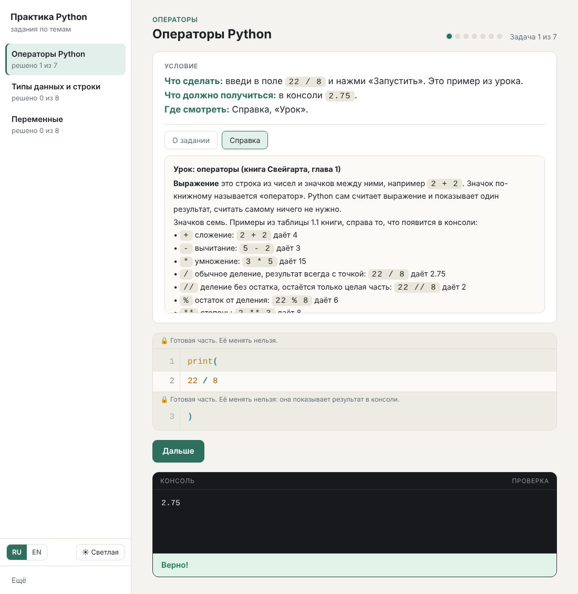

# Python Practice

**English** · [Русский](#практика-python)

A small desktop-style app for beginners who learn Python by solving hands-on tasks. It opens a window with the task text and a help panel, runs the learner's code, checks it and says "correct" or "incorrect". It never shows the ready answer. No internet is needed to use it.

Three ready-made task sets (operators, strings, variables, each in Russian and in English) follow Al Sweigart's book *Automate the Boring Stuff with Python*. You can add your own tasks as plain `.json` files (see [how to make tasks](docs/TASKS.en.md)).

**Two languages and two themes.** The app has an **RU / EN** switch and a **light / dark / auto** theme button at the bottom left. The switch changes the buttons, the messages of the checker and the list of tasks: each task set belongs to one language, and the three sample sets exist in both Russian and English.


## What is inside

| Folder | Contents |
|---|---|
| `app/` | the program itself: `программа.py`, `интерфейс.html` and `build_exe.bat` (exe build) |
| `Задания/` | task files in `.json`: `Task_01-03.json` (English) and `Задание_01-03.json` (Russian) |
| `docs/` | guides: how to load tasks and how to write them |
| `.github/workflows/` | automatic `.exe` build on GitHub |

## How to run

**Option 1. Ready exe (Windows).** Open [Releases](../../releases) and download `PracticePython.exe`. No installation needed. If there is no release yet, build the exe yourself (see below).

**Option 2. From source.** You need Python 3 (tested with 3.13) and Edge or Chrome (the app opens it as an app window). From the repository folder:

```
python app/программа.py
```

The window opens by itself. The program works only on your computer (address 127.0.0.1); nothing is sent to the internet.

## Where results are stored

- Run from source: the `Результаты/` folder next to `Задания/`.
- Run from exe: `Documents/Практика Python/` (it also holds `Задания/` and `Результаты/`).

Each task gets `лог.txt` (every attempt), `прогресс.json` (what is solved) and `результат.txt` (written when all questions are solved).

## How to build the exe

**On your Windows PC.** Install [Python](https://www.python.org/downloads/) (tick "Add python.exe to PATH") and have internet once. Double-click `app/build_exe.bat`. After a couple of minutes the file appears in the `Готовая программа/` folder. The script installs PyInstaller into a temporary environment and removes it afterwards. (The messages of the script are in Russian.)

**On GitHub, without installing anything.** Open the Actions tab, choose "Build exe" and press "Run workflow". The finished `PracticePython.exe` is under Artifacts. If you create a tag such as `v1.0`, the exe is attached to the release automatically. (This workflow mirrors `build_exe.bat` but has not been run on GitHub yet; if it fails, open the log and report it.)

## Your own tasks

A task is a single `.json` file. Load it with the button More → "Add tasks from a file" (bottom left in the app window) or drop it into the `Задания` folder. The field `"lang": "en"` or `"lang": "ru"` in the file decides in which language mode the task set is shown (without it the set is shown in both). If you are not a programmer, ask an AI assistant to write the file: the [guide](docs/TASKS.en.md) has a ready-to-use prompt and rules for writing good tasks. It also describes every field of the file for people who write tasks by hand.

## Learning materials

The book itself and a copy of the Python documentation are not included in this repository: they have their own copyrights and licenses, so please get them from the source.

- Al Sweigart, *Automate the Boring Stuff with Python*, free online edition: <https://automatetheboringstuff.com/>. The sample tasks were written for the Russian edition (2nd edition, "Автоматизация рутинных задач с помощью Python", Dialektika). You can buy the Russian edition, for example, on [Ozon](https://www.ozon.ru/product/avtomatizatsiya-rutinnyh-zadach-s-pomoshchyu-python-prakticheskoe-rukovodstvo-dlya-nachinayushchih-2-340165807/).
- Python documentation: <https://docs.python.org/3/>. The "Tutorial" section is the best start for beginners.

## License

No license has been chosen yet, so by default all rights are reserved by the author. If you want others to use the program freely, add a `LICENSE` file (for example MIT).

---

# Практика Python

[English](#python-practice) · **Русский**

Небольшая программа для новичков: в ней решают практические задания по Python. Она открывает окно, показывает условие и справку, запускает код, проверяет его и говорит «верно» или «неверно». Готовые ответы она не показывает. Интернет для работы не нужен.

Три готовых задания (операторы, строки, переменные) построены по книге Эла Свейгарта «Автоматизация рутинных задач с помощью Python». Свои задания добавляются обычным файлом `.json` (см. [как делать задания](docs/TASKS.ru.md)).

**Два языка и две темы.** Внизу слева в окне есть переключатель **RU / EN** и кнопка темы **светлая / тёмная / авто**. Переключатель меняет надписи, сообщения проверки и список заданий: каждое задание относится к одному языку, а три готовых задания есть и на русском, и на английском.



## Что внутри

| Папка | Что там |
|---|---|
| `app/` | сама программа: `программа.py`, `интерфейс.html` и `build_exe.bat` (сборка exe) |
| `Задания/` | задания в виде `.json`: `Задание_01-03.json` (русские) и `Task_01-03.json` (английские) |
| `docs/` | инструкции: как загружать и делать задания |
| `.github/workflows/` | автоматическая сборка `.exe` на GitHub |

## Как запустить

**Вариант 1. Готовый exe (Windows).** Откройте раздел [Releases](../../releases) и скачайте `PracticePython.exe`. Установка не нужна. Если релизов пока нет, exe можно собрать самим (ниже).

**Вариант 2. Из исходного кода.** Нужен Python 3 (проверено на 3.13) и браузер Edge или Chrome (программа открывает его окном-приложением). Запуск из папки репозитория:

```
python app/программа.py
```

Окно откроется само. Программа работает только на вашем компьютере (адрес 127.0.0.1), в интернет ничего не отправляется.

## Куда пишутся результаты

- Запуск из кода: папка `Результаты/` рядом с `Задания/`.
- Запуск из exe: папка `Документы/Практика Python/` (там же лежат `Задания/` и `Результаты/`).

Для каждого задания пишутся `лог.txt` (каждая попытка), `прогресс.json` (что решено) и `результат.txt` (когда решены все задачи).

## Как собрать exe

**На своём компьютере (Windows).** Нужен установленный [Python](https://www.python.org/downloads/) (при установке отметьте «Add python.exe to PATH») и интернет на один раз. Дважды щёлкните `app/build_exe.bat`. Через пару минут готовый файл появится в папке `Готовая программа/`. Скрипт сам ставит сборщик PyInstaller во временное окружение и потом всё удаляет.

**На GitHub, без установки чего-либо.** Откройте вкладку Actions, выберите «Build exe» и нажмите «Run workflow». Готовый `PracticePython.exe` будет в разделе Artifacts. Если создать тег вида `v1.0`, exe автоматически прикрепится к релизу. (Эта сборка настроена по образцу `build_exe.bat`, но на GitHub ещё не запускалась: если она упадёт, откройте журнал и пришлите его.)

## Свои задания

Задание это один файл `.json`. Загрузить его можно кнопкой «Ещё» → «Добавить задания из файла» (внизу слева в окне программы) или положить в папку `Задания`. Поле `"lang": "ru"` или `"lang": "en"` в файле решает, на каком языке показывается задание (без него задание видно на обоих). Если вы не программист, попросите сделать файл у нейросети (в том числе на другом языке, например, английском): в [инструкции](docs/TASKS.ru.md) есть готовый запрос и правила, как составлять хорошие задания. Там же описаны все поля файла для тех, кто хочет писать задания сам.

## Материалы для учёбы

В репозитории нет самой книги и копии документации: у них свои авторские права и лицензии, поэтому лучше брать их у источника.

- Эл Свейгарт, *Automate the Boring Stuff with Python*, бесплатное онлайн-издание на английском: <https://automatetheboringstuff.com/>. Задания в этом репозитории составлены по русскому изданию (2-е издание, «Автоматизация рутинных задач с помощью Python», издательство «Диалектика»). Русское издание можно купить, например, на [Ozon](https://www.ozon.ru/product/avtomatizatsiya-rutinnyh-zadach-s-pomoshchyu-python-prakticheskoe-rukovodstvo-dlya-nachinayushchih-2-340165807/).
- Документация Python: <https://docs.python.org/3/>, на русском: <https://docs.python.org/ru/3/>. Для новичков подойдёт раздел «Tutorial».

## Лицензия

Лицензия пока не выбрана. Пока она не добавлена, по умолчанию действуют все права автора. Если хотите, чтобы другие могли свободно пользоваться программой, добавьте файл `LICENSE` (например, MIT).
