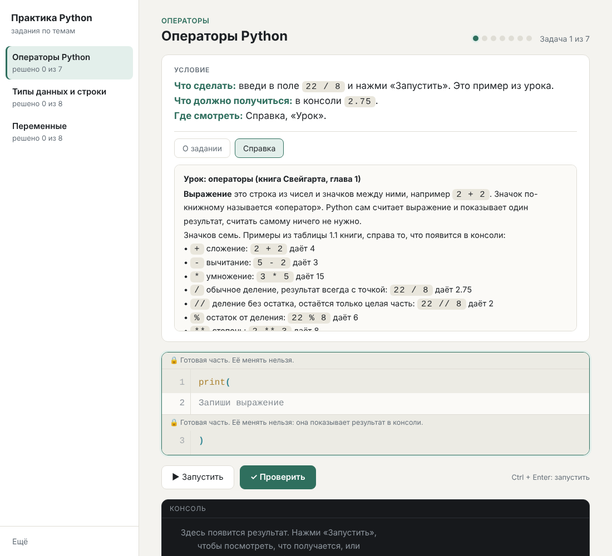

# Python Practice

**English** · [Русский](README.ru.md)

A small desktop-style app for beginners who learn Python by solving hands-on tasks. It opens a window with the task text and a help panel, runs the learner's code, checks it and says "correct" or "incorrect". It never shows the ready answer. No internet is needed to use it.

Three ready-made tasks (operators, strings, variables) follow Al Sweigart's book *Automate the Boring Stuff with Python*. You can add your own tasks as plain `.json` files (see [how to make tasks](docs/TASKS.en.md)).

> **Note:** the interface and the three sample tasks are in Russian. Tasks in other languages work too (the task text is just a string), but the buttons and messages of the app are Russian for now.



## What is inside

| Folder | Contents |
|---|---|
| `app/` | the program itself: `программа.py`, `интерфейс.html` and `build_exe.bat` (exe build) |
| `Задания/` | task files in `.json` (three ready examples) |
| `docs/` | guides: how to load tasks and how to write them |
| `.github/workflows/` | automatic `.exe` build on GitHub |

## How to run

**Option 1. Ready exe (Windows).** Open [Releases](../../releases) and download `PracticePython.exe`. No installation needed. If there is no release yet, build the exe yourself (see below).

**Option 2. From source.** You need Python 3 (tested with 3.13) and Edge or Chrome (the app opens it as an app window). From the repository folder:

```
python app/программа.py
```

The window opens by itself. The program works only on your computer (address 127.0.0.1); nothing is sent to the internet.

## Where results are stored

- Run from source: the `Результаты/` folder next to `Задания/`.
- Run from exe: `Documents/Практика Python/` (it also holds `Задания/` and `Результаты/`).

Each task gets `лог.txt` (every attempt), `прогресс.json` (what is solved) and `результат.txt` (written when all questions are solved).

## How to build the exe

**On your Windows PC.** Install [Python](https://www.python.org/downloads/) (tick "Add python.exe to PATH") and have internet once. Double-click `app/build_exe.bat`. After a couple of minutes the file appears in the `Готовая программа/` folder. The script installs PyInstaller into a temporary environment and removes it afterwards. (The messages of the script are in Russian.)

**On GitHub, without installing anything.** Open the Actions tab, choose "Build exe" and press "Run workflow". The finished `PracticePython.exe` is under Artifacts. If you create a tag such as `v1.0`, the exe is attached to the release automatically. (This workflow mirrors `build_exe.bat` but has not been run on GitHub yet; if it fails, open the log and report it.)

## Your own tasks

A task is a single `.json` file. Load it with the button "Ещё" → "Добавить задания из файла" (bottom left in the app window) or drop it into the `Задания` folder. If you are not a programmer, ask an AI assistant to write the file: the [guide](docs/TASKS.en.md) has a ready-to-use prompt and rules for writing good tasks. It also describes every field of the file for people who write tasks by hand.

## Learning materials

The book itself and a copy of the Python documentation are not included in this repository: they have their own copyrights and licenses, so please get them from the source.

- Al Sweigart, *Automate the Boring Stuff with Python*, free online edition: <https://automatetheboringstuff.com/>. The sample tasks were written for the Russian edition (2nd edition) of the book.
- Python documentation: <https://docs.python.org/3/>. The "Tutorial" section is the best start for beginners.

## License

No license has been chosen yet, so by default all rights are reserved by the author. If you want others to use the program freely, add a `LICENSE` file (for example MIT).
